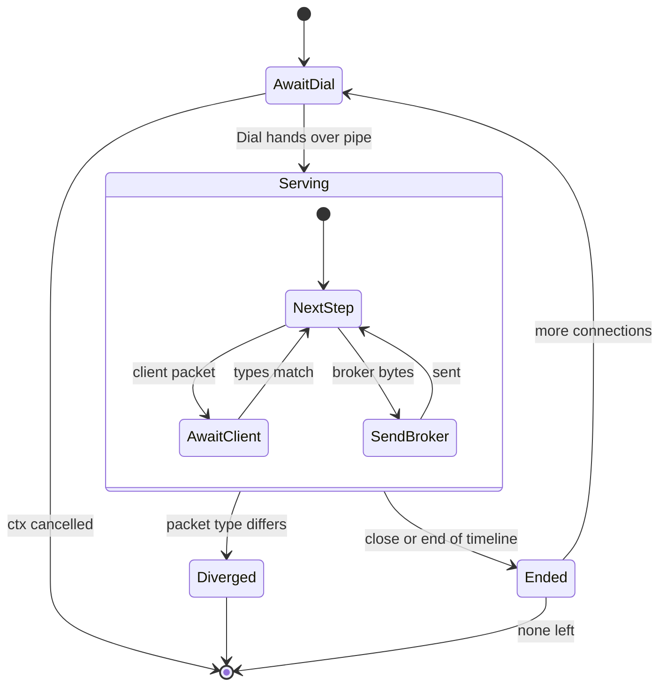
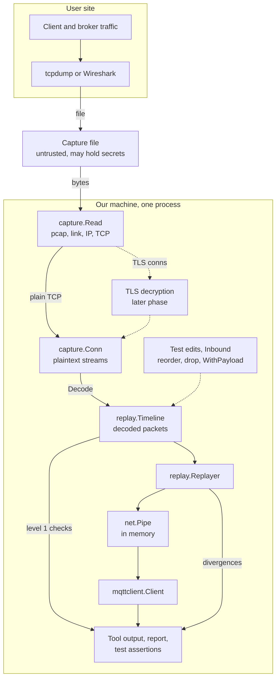
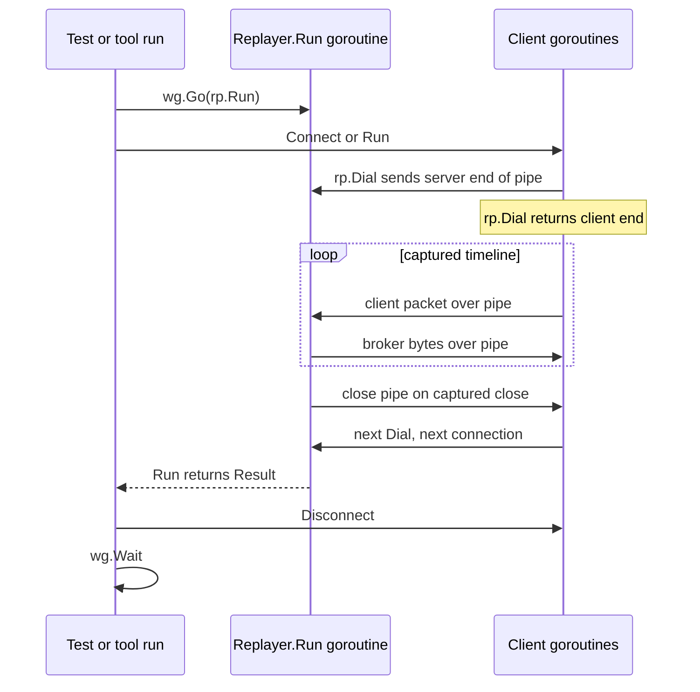

# Packet capture replay: plan

Status: draft · 2026-11-17 · phase 0 and phase 1a implemented (see [Phase 0 outcome](#phase-0-outcome) and [Phase 1 outcome](#phase-1-outcome))

## Goal

A user sends us a packet capture (tcpdump or Wireshark) of an MQTT session that went wrong. We replay the broker's side of it into the real client, using the same code path as `cmd/mqttpub` and `cmd/mqttsub`, so we can reproduce the defect and fix it. Unit tests use the same replay through a Go API, with no capture file needed.

Tests can also read every captured packet's header and payload, and edit the timeline before replaying it: drop, duplicate or reorder packets, or replace a PUBLISH payload. That lets a test check what a capture contains (for example, that every NDATA carries a `Temperature` and a `Pressure` metric) and build scenarios from it (for example, Sparkplug `seq` numbers arriving out of order). See [Inspecting and editing packets](#inspecting-and-editing-packets) and the [proof of concept](#proof-of-concept-sparkplug).

The first pass covers plain TCP (usually port 1883). TLS (8883) is out of scope, but the design leaves one place for it to plug in later without changing anything downstream (see [Adding TLS later](#adding-tls-later)).

## Scope

In scope:

- Captures from both Linux tcpdump (the usual source) and Wireshark, on Linux or Windows (see [Capture sources](#capture-sources)):
  - classic pcap, both byte orders, microsecond and nanosecond timestamps;
  - pcapng with several sections and several interfaces of different link types;
  - gzip-compressed files, as Wireshark can save them.
- Link layers: Ethernet (with 802.1Q VLAN tags), Linux cooked capture v1 and v2 (`tcpdump -i any`), raw IP, and null/loopback (macOS `lo0`, Windows Npcap loopback). IPv4 and IPv6.
- TCP reassembly into one ordered byte stream for each direction of each connection.
- Recognising TLS connections and refusing them with a clear error.
- Replaying a captured connection, or several in order (a reconnect sequence), into a `mqttclient.Client` through `Server.Dial`.
- Decoded packets with every header field and the payload, as an editable timeline that the replayer accepts.
- Replaying an edge node's capture into a subscriber: the PUBLISHes (and Will) an edge node sent are turned into what a broker would deliver to a subscriber (see [Edge-node captures into a subscriber](#edge-node-captures-into-a-subscriber)).
- A proof of concept: Sparkplug tests that check metrics in a capture and replay it with `seq` out of order.
- A `-replay` option in `cli.ConnFlags`, so mqttpub, mqttsub and sparkverify can run against a capture.
- A small tool, `cmd/mqttpcap`, that lists the connections in a capture and prints each one's MQTT packet timeline, so we can see what a capture holds and pick a connection.

Out of scope:

- TLS. This pass detects it; [Adding TLS later](#adding-tls-later) describes how support goes in.
- WebSockets (the client has none; see `PLAN.md`).
- Replaying the client side against a real broker.
- Recreating timing: keepalive expiry, timeouts and races. Replay keeps the order of packets, not the gaps between them.
- IP fragment reassembly. MQTT over TCP almost never fragments at the IP layer. A fragmented packet is reported, not guessed at.
- Spec-checking both sides of a capture in `mqttpcap`. Worth doing later; not needed to reproduce a defect.

## Acceptance criteria

1. `capture.Read` parses every file format and link type in [Scope](#scope), and returns each TCP connection as two reassembled byte streams with timestamps. The real fixtures in [Capture sources](#capture-sources) all read correctly. A file compressed with something other than gzip (zstd, lz4) is refused with an error that names the format and asks for an uncompressed save.
2. Retransmitted and out-of-order segments are reassembled correctly. A gap in a stream (a segment the capture missed) ends that stream with `capture.ErrGap`. It never joins bytes from either side of a gap.
3. A connection whose first bytes from the client are a TLS handshake record is marked `TLS`. Decoding or replaying it returns `capture.ErrEncrypted`.
4. `replay.New(timelines)` plus `Server{Dial: rp.Dial}` runs the real client against the captured broker packets. Broker packets are sent byte for byte as captured (or as edited), except packet identifiers rewritten to match the ones the live client chose.
5. Each difference between what the live client sends and what the captured client sent is reported in `replay.Result`: packet type, topic, QoS, flags, payload length, and the CONNECT fields.
6. A capture holding several connections from the same client replays them in order: when the captured broker closed the connection, the replay closes it too, and the client's next `Dial` gets the next connection. This reproduces reconnect and resend defects under `Client.Run`.
7. `mqttsub -replay cap.pcap -t '#'` and `mqttpub -replay cap.pcap ...` run against the capture, with no network, and exit 0, 1 or 2 by the usual rules. With `-report`, the JSON report includes the replay result.
8. `mqttpcap -list cap.pcap` lists connections. `mqttpcap -conn N cap.pcap` prints the timeline. Passwords are never printed.
9. No new Go module dependencies.
10. Malformed or hostile capture files never panic or exhaust memory. Fuzz targets cover the readers.
11. `replay.Decode` returns each packet's direction, time, type, fixed-header flags (DUP, QoS, RETAIN), packet identifier, topic, MQTT 5 properties, reason codes, payload and raw bytes. A malformed packet keeps its raw bytes and carries its decode error.
12. A test can edit a `Timeline` with ordinary slice operations and `Packet.WithPayload`, and replay the edited timeline. Client acks are matched by packet identifier, so reordering broker PUBLISHes doesn't cause spurious divergences.
13. The [proof of concept](#proof-of-concept-sparkplug) tests pass: metric presence in a capture, faithful delivery of a captured Sparkplug stream, a reordered `seq` caught by `sparkplug/verify`, and an edge node's capture delivered to a subscriber, ending with its NDEATH Will.
14. `replay.Inbound` turns one or more client timelines into a subscriber timeline, following the rules in [Edge-node captures into a subscriber](#edge-node-captures-into-a-subscriber). `mqttsub -replay-inbound` and `sparkverify -replay-inbound` use it.
15. `gofmt -l .`, `go vet ./...`, `go test -race -count=1 ./...` and `golangci-lint run ./...` pass. Every flag is in `-h` output and in the tool READMEs.

## Design

### Packages

| Package | Provides | Knows about |
| --- | --- | --- |
| `capture` | `Read(io.Reader) (*Capture, error)`: connections as ordered, timestamped byte segments | pcap, pcapng, link layers, IP, TCP. Nothing about MQTT. |
| `capture/capturetest` | `Write` for building pcap and pcapng files in tests | The file formats only. |
| `replay` | `Decode` (a `capture.Conn` to an editable `Timeline` of decoded packets) and `Replayer` (serves timelines through `Dial`) | MQTT framing through the comqtt `packets` codec. Nothing about file formats. |
| `cmd/internal/cli` | `-replay` and `-replay-conn` in `ConnFlags`, wiring a `Replayer` into `Server.Dial`, replay section in `Report` | Both packages above. |
| `cmd/mqttpcap` | List connections and print timelines | `capture`, `replay.Decode`. |

`capture` stops at bytes and `replay` starts from bytes. That boundary is the TLS extension point.

### Key types

```go
package capture

type Dir uint8

const (
	FromClient Dir = iota
	FromServer
)

type Transport uint8

const (
	Plain Transport = iota // bytes are MQTT
	TLS                    // bytes are TLS records; see ErrEncrypted
)

// Segment is bytes seen in one direction. Segment boundaries carry no
// meaning: one MQTT packet may span several segments, and one segment may
// hold several packets.
type Segment struct {
	Dir  Dir
	Time time.Time
	Data []byte
}

// Conn is one TCP connection in capture order. Fields are exported so a
// test can build a Conn by hand without a capture file.
type Conn struct {
	Client, Server netip.AddrPort
	Transport      Transport
	Segments       []Segment
	ClientClose    *time.Time // FIN or RST from the client, nil if none was captured
	ServerClose    *time.Time
	Err            error      // why the streams end early (ErrGap, ErrTruncated), or nil
}

type Capture struct {
	Conns   []Conn
	Ignored int // frames that weren't IPv4 TCP, so an empty result can be told from a capture of something else
}

var (
	ErrEncrypted = errors.New("capture: connection is TLS encrypted")
	ErrGap       = errors.New("capture: bytes missing from TCP stream")
	ErrTruncated = errors.New("capture: packet truncated by snap length")
	ErrFormat    = errors.New("capture: unsupported or invalid capture file")
	ErrDirection = errors.New("capture: cannot tell client from server")
)
```

```go
package replay

// Packet is one decoded MQTT control packet, or a captured close. Fields
// that don't apply to the packet type are zero. Packet is a value: Decode
// gives each Packet its own Raw and Payload, so editing one never changes
// another.
type Packet struct {
	Dir  capture.Dir
	Time time.Time

	// Close marks a FIN or RST from Dir. A close has no bytes.
	Close bool

	// Auto marks a packet the Replayer fills in from the live client
	// instead of sending or comparing it as captured. An Auto client
	// packet is matched by type only. An Auto broker CONNACK, SUBACK or
	// UNSUBACK accepts what the live client asked for (granted QoS =
	// requested QoS). Inbound uses it; tests that build timelines by hand
	// may too.
	Auto bool

	Type        byte // control packet type, 1 (CONNECT) to 15 (AUTH)
	Dup         bool
	QoS         byte
	Retain      bool
	PacketID    uint16
	Topic       string
	Properties  *mqttclient.Properties // MQTT 5 only; nil otherwise
	ReasonCodes []byte                 // CONNACK, PUBACK ... SUBACK, UNSUBACK, DISCONNECT
	Payload     []byte                 // PUBLISH only
	Connect     *ConnectInfo           // CONNECT only: version, client ID, clean, keepalive, Will; never the username or password
	Filters     []mqttclient.Subscription // SUBSCRIBE; UNSUBSCRIBE (Topic only)

	// Raw is the whole packet as captured, or as rebuilt by WithPayload.
	// It is what the Replayer sends. Editing the decoded fields above
	// doesn't change Raw.
	Raw []byte

	// Err is why the packet couldn't be decoded (wraps
	// mqttclient.ErrMalformedPacket). Raw is still set and still replayed.
	Err error
}

// WithPayload returns a copy of a PUBLISH with its payload replaced and Raw
// rebuilt. The topic, packet identifier, flags and properties bytes are
// kept as captured. It returns an error for any other packet type.
func (p Packet) WithPayload(b []byte) (Packet, error)

// Timeline is one connection's packets in capture order.
type Timeline struct {
	Client, Server netip.AddrPort
	Version        byte // MQTT protocol version
	Packets        []Packet
}

// Decode turns a plaintext connection into a timeline. version is used
// when the capture has no CONNECT; 0 means read it from CONNECT. It returns
// capture.ErrEncrypted for a TLS connection.
func Decode(c capture.Conn, version byte) (Timeline, error)

// Inbound turns timelines captured from publishing clients (edge nodes)
// into one timeline that delivers their messages to a subscriber, as a
// broker would. See "Edge-node captures into a subscriber".
func Inbound(clients []Timeline) (Timeline, error)

func New(timelines []Timeline) (*Replayer, error)

// Dial has the signature of Server.Dial. Each call hands the next timeline
// to Run and returns the client's end of an in-memory pipe.
func (r *Replayer) Dial(ctx context.Context, network, address string) (net.Conn, error)

// Run serves timelines handed over by Dial, in order, until every timeline
// is replayed or ctx is cancelled.
func (r *Replayer) Run(ctx context.Context) (Result, error)
```

`mqttclient.Properties` is already an alias of the comqtt `packets.Properties`, so `replay` decodes properties with comqtt and exposes them without a new type. `Type` is a plain byte, and `replay` defines the spec's 15 type values as its own constants (`replay.Connect` ... `replay.Auth`), so its API doesn't commit to comqtt's. `Packet.TypeName()` gives the spec name for messages.

How it's used in a unit test:

```go
tl, err := replay.Decode(conn, 0)
// ... optionally inspect or edit tl.Packets ...
rp, err := replay.New([]replay.Timeline{tl})
// ...
var wg sync.WaitGroup
var res replay.Result
var runErr error
wg.Go(func() { res, runErr = rp.Run(ctx) })
c, err := mqttclient.New(mqttclient.Options{Servers: []mqttclient.Server{{
	Address:         conn.Server.String(),
	ProtocolVersion: mqttclient.MQTT5,
	Dial:            rp.Dial,
}}}, handlers)
// ... connect, subscribe, check what the handlers saw ...
wg.Wait()
// check res.Divergences and runErr
```

`Run` is synchronous, following the concurrency rules: the caller decides to run it in a goroutine and waits for it. `Dial` passes the server end of the pipe to `Run` on a channel ("send the thing"), selecting on both its own `ctx` and the replayer's stop signal. After the last captured connection, `Dial` returns `replay.ErrExhausted`, which the client reports through `OnConnectError`.

### Lockstep replay

The broker's bytes were responses to what the client sent, so the replay can't simply stream them. It walks the timeline of the connection in order:

- **Client packet that starts an exchange** (CONNECT, PUBLISH, SUBSCRIBE, UNSUBSCRIBE, PUBREL for the client's own QoS 2 message, DISCONNECT): wait for the live client's next such packet. Compare them, record any difference in `Result.Divergences`, and map the captured packet identifier to the live one. If the packet types differ, stop replaying this connection and record why. Nothing after that point would mean anything.
- **Client ack of a broker PUBLISH** (PUBACK, PUBREC, PUBCOMP): not waited for by position. Acks are matched by packet identifier. Every broker PUBLISH at QoS 1 or 2 must get the right ack before the connection ends, and an ack for an identifier the broker never sent is a divergence. A broker PUBREL waits for the live client's PUBREC with the same identifier. Matching by identifier rather than position keeps edited timelines (reordered or dropped broker PUBLISHes) replayable without spurious divergences.
- **Broker packet:** for packets whose identifier was chosen by the client (PUBACK, PUBREC, PUBCOMP, SUBACK, UNSUBACK), patch the two identifier bytes after the fixed header using the map. Everything else, including inbound PUBLISH and malformed packets, goes out byte for byte. Sending captured bytes, rather than re-encoding decoded packets, keeps malformed packets malformed, which matters when the defect is in our decoder.
- **Auto packets:** an Auto client packet waits for the live client's next packet of that type, with no comparison. An Auto CONNACK, SUBACK or UNSUBACK is built from the live CONNECT, SUBSCRIBE or UNSUBSCRIBE: accepted, with the requested QoS granted for every filter.
- **Ping traffic** depends on timing, so captured PINGREQ and PINGRESP are skipped. A live PINGREQ is answered with PINGRESP straight away.
- **Captured broker close:** close the pipe. Under `Client.Run` the client reconnects and its next `Dial` gets the next captured connection.
- **Captured client close or DISCONNECT:** wait for the live client to close or send DISCONNECT.
- **End of the timeline without a close:** the Replayer keeps answering (acks, pings) until the live client disconnects, then reports any acknowledgement the client never sent and moves on to the next timeline. The caller decides when the run ends. For the CLI (phase 1c), the Replayer needs a way to say the timeline is finished, so the tool can disconnect like `-W` expiring.

Waits select on `ctx.Done()`, so they never block forever. In the CLI, `ctx` carries `-timeout`.

For a live client to line up with a capture, it must be configured the way the captured client was (protocol version, client ID, topics, QoS). The replay compares the live CONNECT with the captured one and reports differences. A protocol version mismatch is fatal, with a message saying which `-v` to use.

### Choosing client and server

`capture` names the client as the side that sent SYN. If the SYN wasn't captured, the client is the side whose first bytes look like a CONNECT (`0x10`). If neither applies, the side using the well-known port (1883, 8883) is the server. If that fails too, `Read` returns the connection with `Err` set, and `mqttpcap -list` shows it as undetermined.

### CLI

`cli.ConnFlags` gains:

- `-replay FILE`: replay this capture in place of connecting to a broker. With it, `-address` defaults to the captured server address. Setting it with `-tls` or `-config` is a setup error (exit 2).
- `-replay-conn LIST`: which connections to replay, as comma-separated indexes from `mqttpcap -list`. The default is all plain-TCP connections in capture order.
- `-replay-inbound`: the capture is from publishing clients (edge nodes). Deliver their messages to this tool as a subscriber, using `replay.Inbound` on the `-replay-conn` connections. Registered only by tools that subscribe (mqttsub, sparkverify).

`cli.Session` owns the replay goroutine: `Start` starts it with `wg.Go`, and `Disconnect` and the end of the run wait for it. `cli.Report` gains a `replay` object (file, connections replayed, divergences). Under the report's schema rules, a new field doesn't bump `ReportSchema`.

`cmd/mqttpcap` follows the tool shape in `bestpractices_go.md` (`run(args, stdout, stderr) int`, own `flag.FlagSet`, exit 0/1/2):

- `-list`: one line per connection with index, addresses, transport, number of bytes each way, and `Err`.
- `-conn N`: the timeline of connection N: time, direction, packet type, identifier, topic, QoS, flags, payload length.
- `-v VERSION`: protocol version, for captures with no CONNECT.
- `-payload`: also print payloads. Off by default, since captures from users hold their data.

### Resource limits

A capture file is untrusted input.

- Each pcap or pcapng record is limited to its declared snap length, and to 256 KiB at most. Larger records are rejected with `ErrFormat`.
- Out-of-order TCP segments waiting for a gap to fill are limited to 4 MiB per stream. Past that the stream ends with `ErrGap`.
- `Decode` needs no packet size limit: it frames packets from bytes already read, so a large declared length only means the packet is incomplete.
- The whole file is read in one pass. Memory grows with the reassembled MQTT payload, not with the file size. Ethernet framing and duplicate segments are dropped as they're read.

These are constants, not options. Per the Code rules, they become options only if a real capture needs it.

### Capture sources

Most captures will come from Linux tcpdump, but some will come from Wireshark, on Linux or Windows. Both are supported in phase 1. What each one produces:

| Source | Typical file | What `capture` must handle |
| --- | --- | --- |
| `tcpdump -i any -w` on Linux | classic pcap, Linux cooked capture (v2 with libpcap 1.10 and later, v1 before) | Cooked headers; the same segment seen on two interfaces (dropped as a duplicate) |
| `tcpdump -i eth0 -w` | classic pcap, Ethernet, maybe VLAN tags | Byte order of the writing host; nanosecond timestamps with `--time-stamp-precision=nano` |
| Wireshark or dumpcap on Linux | pcapng, one section, often several interfaces | A link type per interface, timestamp resolution per interface (`if_tsresol`), Enhanced and Simple Packet Blocks; skip Name Resolution, Interface Statistics and other blocks |
| Wireshark on Windows (Npcap) | pcapng, Ethernet; Npcap loopback for `localhost` traffic | Null/loopback link type, which carries the address family in host byte order |
| Wireshark "save compressed" | pcapng or pcap inside gzip | Detect the gzip magic and read through `compress/gzip`. zstd and lz4 need dependencies, so they're refused with a clear message instead. |

Older Wireshark files may contain obsolete Packet Blocks. They're read too: the format is small and fully specified.

The READMEs give users one recommended command for each source:

- Linux: `tcpdump -i any -s 0 -w mqtt.pcap 'tcp port 1883'`.
- Wireshark: capture filter `tcp port 1883`, then *File → Save As* pcapng.

Real fixtures, all recorded against a local mosquitto with test data only:

1. `tcpdump -i any` (Linux cooked v2).
2. `tcpdump -i lo --time-stamp-precision=nano` (Ethernet framing on loopback, nanosecond pcap).
3. dumpcap on two interfaces, saved as pcapng.
4. The same file saved gzip-compressed from Wireshark.
5. A Wireshark capture on Windows with Npcap loopback.

Fixture 5 needs someone with a Windows machine. Until then, a fixture built with `capturetest` covers the null/loopback link type, and the gap is listed in `capture/testdata/README.md`.

## Inspecting and editing packets

Tests work at three levels. Each answers a different question about a defect report.

| Level | Question | How |
| --- | --- | --- |
| 1. Capture | What did the other side actually send? Did the edge node include `Temperature`? | `replay.Decode`, then read `Packet` fields. For Sparkplug, `sparkplug.ParseTopic` and `sparkplug.Unmarshal` on `Topic` and `Payload`. No client involved. |
| 2. Replay | Did our client deliver exactly what arrived, in order, with nothing lost or duplicated? | Replay the timeline unchanged. Compare what `Handlers.OnMessage` receives with the captured PUBLISHes. |
| 3. Edited replay | How does our stack, or code on top of it, handle a scenario the capture almost shows? | Edit `Timeline.Packets`, then replay. Check handler results, and for Sparkplug, `sparkplug/verify`. |

Editing uses ordinary Go, not a special API:

- Reorder, drop or duplicate packets with `slices` functions on `tl.Packets`.
- Replace a PUBLISH payload with `p.WithPayload(b)`. For Sparkplug: `sparkplug.Unmarshal`, change `Seq` or `Metrics`, `Marshal`, then `WithPayload`.
- Build a timeline from scratch by filling `Timeline.Packets` with `Raw` bytes, when no capture exists.

`replay` knows nothing about Sparkplug. Tests combine it with the existing `sparkplug` and `sparkplug/verify` packages, so neither package depends on the other.

Captures from the edge-node side (our client publishing) work at level 1 too: filter on `p.Dir == capture.FromClient`. At level 2, replay compares the live client's PUBLISHes with the captured ones and reports differences in topic, QoS, flags and payload length.

### Edge-node captures into a subscriber

A capture taken at an edge node, or at a broker with several edge nodes connected, shows what the edge nodes published. `replay.Inbound` turns that into what a broker would deliver to a subscriber, so a host-application test (or `sparkverify -replay-inbound`) consumes the edge nodes' real output.

`Inbound(clients []Timeline)` builds one timeline:

1. **Handshake.** An Auto client CONNECT, then an Auto CONNACK, then an Auto client SUBSCRIBE and an Auto SUBACK. The subscriber can use any client ID and any filters.
2. **Messages.** Every client PUBLISH from the given timelines, merged in capture time order (stable, so one edge node's order is never changed), becomes a broker PUBLISH:
   - **Topic aliases** (MQTT 5) belong to the edge node's connection, not the subscriber's. Each alias is resolved to its topic and the Topic Alias property is removed.
   - **RETAIN** is cleared, as a broker does when forwarding to an existing subscription. **DUP** is cleared.
   - **QoS** is kept as published.
   - **Packet identifiers** are renumbered from 1, because several edge nodes may have used the same ones.
   - **Payloads** are kept byte for byte. The variable header is re-encoded, as a real broker's would be.
3. **QoS 2.** Each QoS 2 PUBLISH is followed by a broker PUBREL, which waits for the subscriber's PUBREC with the same identifier.
4. **Wills.** If a captured connection ends without a normal DISCONNECT (a close with no DISCONNECT, or MQTT 5 reason 0x04) and its CONNECT had a Will, the Will is delivered at that point in time order. For Sparkplug, that is the edge node's NDEATH. MQTT 5 Will Delay Interval is ignored: replay keeps order, not timing.
5. **Version.** The output keeps the captured protocol version. The subscriber must use the same one. A mix of versions across `clients` is an error.

`Inbound` returns an error, naming the timeline and packet index, for anything it can't turn into a broker packet honestly: a malformed PUBLISH, an alias with no topic seen before it, or a timeline with no CONNECT. A test that wants to go ahead anyway drops those packets first. `Inbound` never skips them silently.

`Inbound` is a `Timeline` → `Timeline` function, so its output can be edited and replayed like any other timeline.


## Proof of concept: Sparkplug

A small slice of the design, built first, to prove the API before the rest of phase 1. It lives in `replay/sparkplug_test.go` (package `replay_test`).

### Fixtures

**Host-application session.** A test helper builds one host-application session as a `capture.Conn` and passes it through `capturetest.Write` and `capture.Read`. That way the proof of concept also goes through the file path. The session:

1. Client CONNECT (MQTT 3.1.1), broker CONNACK.
2. Client SUBSCRIBE `spBv1.0/#` at QoS 1, broker SUBACK.
3. Broker PUBLISHes at QoS 1, from one `sparkplug.Edge` (`plant1/press7`): NBIRTH (seq 0, with `Temperature` and `Pressure`), then NDATA with seq 1, 2 and 3, each carrying both metrics. Each is followed by the client's PUBACK.
4. Client DISCONNECT.

**Edge-node session.** A second helper builds the session of an edge node, from the publisher's side:

1. Client CONNECT with a Will: NDEATH from `sparkplug.Edge.Death`.
2. Client PUBLISHes NBIRTH, then NDATA with seq 1 to 3, at QoS 1. Broker PUBACKs.
3. The broker side closes the connection with no DISCONNECT, as if the edge node's network dropped.

Building both from `sparkplug.Edge` keeps the fixtures readable and reuses existing code. Phase 1a adds the real fixtures listed in [Capture sources](#capture-sources).

### Tests

**Level 1: the capture has the metrics.**

```go
func TestDecode_SparkplugNDATA_HasTemperatureAndPressure(t *testing.T) {
	tl := sparkplugTimeline(t) // fixture, through pcap write and read
	var n int
	for _, p := range tl.Packets {
		if p.Dir != capture.FromServer || p.Type != replay.Publish {
			continue
		}
		top, err := sparkplug.ParseTopic(p.Topic)
		if err != nil || top.Type != sparkplug.NDATA {
			continue
		}
		pl, err := sparkplug.Unmarshal(p.Payload)
		if err != nil {
			t.Errorf("NDATA at %v: %v", p.Time, err)
			continue
		}
		for _, name := range []string{"Temperature", "Pressure"} {
			if pl.Metric(name) == nil {
				t.Errorf("NDATA seq %d: no %s metric", *pl.Seq, name)
			}
		}
		n++
	}
	if n != 3 {
		t.Errorf("got %d NDATA, want 3", n)
	}
}
```

**Level 2: the client delivers the captured stream unchanged.**
`TestReplay_SparkplugSession_DeliversEveryMessageUnchanged` replays the timeline into a real `mqttclient.Client` subscribed to `spBv1.0/#`. `OnMessage` sends each message on a buffered channel. The test then checks:

- the topics and payloads received, in order, are byte-equal to the captured broker PUBLISHes;
- a `verify.Verifier` fed with them reports `OK()`;
- `replay.Result` has no divergences.

**Level 3: edited `seq` order is delivered as edited, and the verifier catches it.**
`TestReplay_SparkplugSeqEdited_VerifierReportsViolation` is table-driven:

| Case | Edit | Delivered seq | Violation kinds |
| --- | --- | --- | --- |
| swapped | swap the NDATA packets with seq 2 and 3 | 0 1 3 2 | gap, reorder |
| dropped | delete the NDATA with seq 2 | 0 1 3 | gap |
| rewritten | NDATA seq 3 payload rewritten to seq 2 with `WithPayload` | 0 1 2 2 | duplicate |

Each case checks two things:

- The client delivered exactly the edited order, so it neither reorders nor drops.
- `verify.Report().Violations` has the expected kinds, so the scenario is caught.

The "rewritten" case proves payload editing. The other two prove that reordering and dropping QoS 1 PUBLISHes doesn't upset ack matching.

**Edge node into a subscriber.**
`TestInbound_EdgeSessionCapture_SubscriberReceivesStreamAndDeath` decodes the edge-node fixture and calls `replay.Inbound`. It replays the result into a real client subscribed to `spBv1.0/#`, then checks:

- the client received NBIRTH, NDATA 1 to 3, and then NDEATH, with payloads byte-equal to what the edge node published (and, for NDEATH, to its Will);
- no message arrived with RETAIN or DUP set;
- the verifier reports `OK()`, with one birth, one death and a matching bdSeq.

All four tests run on `net.Pipe`, in memory, well under 100 ms.

### What the proof of concept builds

Only what these tests need:

- **`capture`:** classic pcap, Ethernet, IPv4, and TCP in order. Missing bytes end the stream with `ErrGap`; out-of-order buffering is left out.
- **`capturetest.Write`:** classic pcap only.
- **`replay`:** `Decode`, `Packet` (with `Auto`), `WithPayload`, `Timeline`, and the `Replayer` for one connection. Lockstep covers CONNECT, SUBSCRIBE, broker PUBLISH at QoS 0 and 1 with acks matched by identifier, Auto packets, and DISCONNECT.
- **`Inbound`:** for MQTT 3.1.1 at QoS 0 and 1, including Wills. MQTT 5 topic aliases and QoS 2 are left for phase 1b.
- **Not included:** pcapng, other link types, IPv6, QoS 2, reconnect sequences, the CLI, or `mqttpcap`.

Estimate: 4–6 days. If the API doesn't hold up in these tests, we change it before phase 1 builds on it.

## Adding TLS later

Everything below `capture.Conn` works on plaintext bytes and refuses `Transport == TLS`. Supporting TLS later means producing a plaintext `Conn` from a TLS one. Nothing in `replay`, `cli` or the tools changes.

The first pass prepares for this by:

1. **Having one boundary type.** `capture.Conn` with `Transport` is the only thing that crosses from "bytes on the wire" to "MQTT". A decryption step is a function from `Conn` to `Conn`.
2. **Detecting TLS now.** A TLS stream starts with a handshake record (`0x16 0x03 0x00`–`0x04`). It's marked `TLS`, listed as such by `mqttpcap -list`, and refused with `ErrEncrypted`. The user gets a clear message, not garbage decoded as MQTT.
3. **Treating segment boundaries as meaningless.** `replay` frames MQTT packets from the joined byte stream and never assumes a segment is a packet. Decrypted TLS records split and merge MQTT packets differently from TCP segments. Phase 1 tests prove this by splitting every fixture at every byte offset.
4. **Replaying in plaintext.** The replay pipe is in-process. A replayed TLS capture runs with the client's TLS off, so `-replay` with `-tls` stays a setup error. Nothing goes over a network, so no security setting is weakened. Replaying the TLS handshake itself isn't possible without the server's private key and the original random values; that's a non-goal.
5. **Looking up link types in a table.** Link-type decoders are entries in an unexported map from link type to function. Adding Wireshark's exported-PDU link type (option A below) is a new entry, not a change to a growing `switch`.

Two ways to add TLS:

- **Option A: Wireshark export (about 1–2 days).** The user, or we, decrypt in Wireshark with a key log file and use *File → Export PDUs to File*, which writes the decrypted bytes as a pcapng with link type `WIRESHARK_UPPER_PDU` (252). `capture` adds that link type and builds plaintext `Conn`s from it. Wireshark does the cryptography.
- **Option B: built-in decryption (about 1–2 weeks).** `capture.Decrypt(c Conn, keylog io.Reader) (Conn, error)` reads an NSS key log file (`SSLKEYLOGFILE` format) and decrypts TLS 1.2 (ECDHE with AES-GCM or ChaCha20-Poly1305) and TLS 1.3 records, using `crypto/aes`, `crypto/cipher`, `crypto/hkdf` and `golang.org/x/crypto/chacha20poly1305`. The last one is a new dependency and needs review. `cli` gains `-replay-keylog FILE`. A failed authentication tag is an error, never skipped ("data must not lie").

Either way, users need a key log. Applications on the library can already set `Server.TLSConfig.KeyLogWriter`. For our tools, a documented `-tls-keylog FILE` flag in `cli.ConnFlags` would write one. Its help text and README must say the file is secret key material. It's off by default and never turned on implicitly, so the default stays secure.

Start with option A. Move to option B only if users can't run Wireshark.

## Key risks

| Risk | Cheapest effective reduction |
| --- | --- |
| Reassembly joins bytes across a gap, so the replay delivers data that lies | Unit tests with missing, duplicated, overlapping and reordered segments. A gap ends the stream with `ErrGap`, and the test checks that no bytes after the gap appear. |
| Our pcap writer and reader share the same misunderstanding of the format, so tests pass but real files fail | Commit the small real fixtures listed in [Capture sources](#capture-sources) under `capture/testdata/`. Tests read them. |
| A Wireshark file uses a pcapng feature we didn't expect (several interfaces, per-interface timestamp resolution, unknown blocks) | The multi-interface dumpcap fixture, plus `capturetest` cases for each block type and for unknown blocks being skipped by their length. |
| `Inbound` delivers something no real broker would, so a test passes or fails for the wrong reason | Each rule in [Edge-node captures into a subscriber](#edge-node-captures-into-a-subscriber) has a table test: alias resolved and removed, RETAIN and DUP cleared, identifiers unique across edge nodes, Will delivered only after an abnormal end. For the Will rule, also a one-off manual comparison against mosquitto: replay the same edge session through a real broker and compare what a subscriber gets. |
| Merging several edge nodes changes one node's message order | Test with two interleaved edge timelines: each node's messages keep their order, and the merge is stable for equal timestamps. |
| A hostile file panics or exhausts memory | `FuzzRead` and `FuzzDecode` (Go native fuzzing, seeded with the fixtures), plus the [resource limits](#resource-limits) with tests at each limit. |
| Lockstep replay deadlocks: the replay and the client wait on each other | Every wait selects on `ctx.Done()`. Each test runs under `t.Context()`, so a hang fails instead of stalling. A test where the client never sends the expected packet checks that `Run` returns with that recorded as the reason. |
| Packet identifier rewriting acks the wrong message, hiding or inventing a defect | Table test: captured identifiers differ from live ones, and the client's `OnPublish` callbacks name the live identifiers. A test with an unmapped identifier sends it unchanged and records a divergence. |
| Segment boundaries leak into MQTT framing, so TLS (or odd TCP stacks) breaks replay later | Test that splits each fixture's streams at every byte offset and checks that `Decode` gives the same packets. |
| Passwords from captures appear in output or reports | Test that `mqttpcap` and the replay report, given a CONNECT with a password, never contain the password bytes. |
| The tools behave differently under replay than against a broker | mqttpub and mqttsub tests run once against `clitest.Broker` and once against a capture of the same exchange, and compare the reports. |
| Reconnect replay hands the wrong connection to the client | Test with two captured connections and `Client.Run`: the second `Dial` gets the second connection, and the resent QoS 1 PUBLISH has DUP set. |
| A real user capture is from the middle of a session (no CONNECT or SYN) | `mqttpcap` decodes it with `-v`. Replay refuses it with a message that says so. A test covers both. |
| `WithPayload` rebuilds the remaining length wrong, so an edited replay fails in a way that looks like a client bug | Round-trip test: `WithPayload` then `Decode` gives back the new payload and the original topic, identifier, flags and properties. Payload sizes cross each remaining-length byte boundary (127/128, 16383/16384). |
| Editing one packet changes another through a shared backing array | Test: change `Payload` and `Raw` of one decoded packet, and check that the other packets and a second `Decode` of the same `Conn` are unchanged. |
| Edited timelines produce spurious divergences, hiding real ones | The proof-of-concept "swapped" and "dropped" cases assert no divergences beyond the expected ones. Acks are matched by identifier, not position. |
| An edited-replay test passes because it checks the verifier, not the client | Level 3 tests also assert the exact order the client delivered, so a client that reorders or drops fails the test even if the verifier result matches. |

Every unit test above uses `net.Pipe` and in-memory captures and runs under 100 ms, so none needs `integration/`. Recording the real fixtures is a one-off manual step, documented in `capture/testdata/README.md`.

Regression tests for user-reported defects should build a `capture.Conn` by hand, or use a trimmed capture holding only test data. Don't commit a user's capture: it may hold their passwords, topics and process data.

## Design patterns

| Pattern | Used for | Go construct |
| --- | --- | --- |
| Pipeline | file → records → link/IP/TCP decode → reassembly → (TLS decryption later) → MQTT framing | Plain function calls in sequence over in-memory data. No goroutines: the file is read once, in order. |
| Adapter | Serving a capture through the client's existing dial hook | `Replayer.Dial` has the `Server.Dial` signature and returns a `net.Pipe` end. |
| State machine | One replayed connection (diagram below) | One goroutine (`Run`) owns the state and walks the timeline. No shared state. |
| Lookup table | Link-type decoders | Unexported `map[uint32]func([]byte) (ipPacket, error)`, built once and never changed. |

Considered and rejected:

- **Strategy interface for capture sources or decryptors.** There's one implementation now. TLS plugs in as a `Conn` → `Conn` function, and an interface waits until a second real implementation exists (open/closed rule in `bestpractices_go.md`).
- **Goroutine per pipeline stage.** The input is a finite file read once. Channels between stages would add lifetimes to manage and buy nothing.
- **Re-encoding broker packets from decoded form.** Would change malformed bytes and property order, hiding exactly the defects we're looking for.
- **An edit API on `Timeline` (`Swap`, `Drop`, `SetSeq`).** `slices` and `WithPayload` already cover it. A Sparkplug-aware helper such as `SetSeq` would also make `replay` depend on `sparkplug`. If many tests end up repeating the same Sparkplug edits, those helpers go in a `sparkplug/sparkplugtest` package, not in `replay`.
- **gopacket.** It would save the reader and reassembly work, but it's a large dependency that users' security reviews would have to pass.

## SOLID

| Component | S | O | L | I | D |
| --- | --- | --- | --- | --- | --- |
| `capture` | Turns capture files into TCP byte streams; changes only when file or network formats do | New link types are table entries; TLS is a new `Conn` → `Conn` function, without editing reassembly | No interface yet; doesn't apply | No interface; callers use `Read` and the `Conn` struct | Takes an `io.Reader`, not a path. No globals: the link-type table is a constant lookup table |
| `replay` | Decodes MQTT timelines and serves them to a live client; changes only when MQTT framing or replay rules do | Accepts any plaintext `Conn`, however it was produced. New test scenarios are edits to a `Timeline`, not new replay code | `Dial` honours the `Server.Dial` contract: returns a usable `net.Conn` or an error, respects `ctx` | Depends on `capture.Conn` (data), not an interface | Takes `[]Timeline` from the caller; tests decode, edit or build them |
| `cli` changes | `ConnFlags` still only describes connections; `Session` still owns the client and now the replay goroutine | Replay is one more way to fill `Server.Dial` | Doesn't apply | Doesn't apply | `main` and `run` wire the concrete `Replayer` in |
| `cmd/mqttpcap` | Prints what a capture holds | Doesn't apply | Doesn't apply | Doesn't apply | Writes only to the `stdout` and `stderr` it's given |

## Diagrams

### Replayed connection state



`Ended` covers a captured broker close, the live client closing, and reaching the end of the captured timeline. Live PINGREQs are answered inside `AwaitClient` and don't change state.

### Data flow and trust boundaries



The only trust boundary is the capture file entering `capture.Read`. Nothing leaves the process over a network.

### Concurrency



`Run` is the only replay goroutine. Its owner (the test, or `cli.Session`) starts it and waits for it. Each blocking send or receive in `Dial` and `Run` also selects on `ctx.Done()`. The client's own goroutines (reader, keepalive, dispatcher) are unchanged.

## Security

- **Purdue model.** Replay and `mqttpcap` open no network connections and listen on no ports. The client talks to an in-memory pipe. No new connections or directions for an auditor to review. Doesn't affect level skipping.
- **Access control.** The live client in a replay runs without TLS, in-process. `-replay` refuses `-tls`, so a replay can never be mistaken for a secured connection. Server verification defaults are untouched. The later `-tls-keylog` flag is off by default, documented as secret, and never on implicitly.
- **Secrets in captures.** CONNECT passwords are never printed or reported (test above). Payloads print only with `-payload`. The READMEs tell users what a capture contains before they send one, and to capture with test credentials where they can.
- **Monitoring.** Decode failures, gaps, encrypted connections and divergences are returned errors, report fields and non-zero exit statuses. None are only logged.
- **Patching.** No new dependencies in phase 1. TLS option B would add `golang.org/x/crypto`, which needs human review.
- **Untrusted input.** Resource limits and fuzz targets, as above. The library packages never panic on file contents.

## Phases and effort

| Phase | Work | Estimate |
| --- | --- | --- |
| 0 | [Proof of concept](#proof-of-concept-sparkplug): minimal `capture`, `capturetest`, `Decode`, `Packet`, `WithPayload`, single-connection `Replayer`, basic `Inbound`, four Sparkplug tests | 4–6 days |
| 1a | `capture`: the rest of pcap, pcapng with several interfaces, gzip, all link types, IPv4/IPv6, TCP reassembly, TLS detection, limits, fuzz targets, real fixtures | 5–7 days |
| 1b | `replay`: QoS 2, full lockstep and divergence reporting, reconnect sequences, `Inbound` for MQTT 5 aliases and QoS 2 | 3–5 days |
| 1c | `cli` flags (including `-replay-inbound`) and report, mqttpub/mqttsub/sparkverify tests, `cmd/mqttpcap`, READMEs with capture instructions | 2–3 days |
| 2 | TLS option A (exported PDUs), `-tls-keylog` | 2–3 days |
| 2 alt | TLS option B (built-in decryption) | 1–2 weeks |

## Dependencies

No changes to `go.mod`, `go.upstream.mod` or `integration/go.mod` in phase 1. TLS option B would add `golang.org/x/crypto`, listed here for review when that phase is planned.

## Decisions

1. **Capture sources (2026-11-17).** Captures come mostly from Linux tcpdump, sometimes from Wireshark. Both are supported in phase 1. See [Capture sources](#capture-sources).
2. **Edge-node captures into a subscriber (2026-11-17).** Yes, in scope, including the proof of concept. See [Edge-node captures into a subscriber](#edge-node-captures-into-a-subscriber).

## Open questions

1. Should `mqttpcap` grow spec checks on both sides (unanswered QoS 1/2, acks for unknown identifiers, keepalive gaps)? Useful, but not needed to reproduce a defect.
2. Should we provide a capture sanitiser (strip passwords and payloads) so users can send captures more easily, and so we can commit them as regression fixtures?
3. Who can record the Windows Npcap fixture?

## Standards this plan touches

- **principles.md:**
  - *Failures must not be hidden*: gaps, encryption and divergences are errors or report fields.
  - *Fail safe*: `ErrGap` rather than joining streams, and replay refuses `-tls`.
  - *Options*: `-replay`, `-replay-conn` and `-replay-inbound` exist because a test tool needs them to reproduce a scenario.
  - *No hidden flags*: all documented.
  - *Dependencies*: none added.
  - *What a plan contains*: all sections present.
  - *Diagrams*: three included.
  - *Security compliance*: section above.
  - *Data path integrity*: byte-for-byte broker replay.
- **writingtests.md:**
  - Risk table with the cheapest reduction for each risk.
  - Deterministic unit tests on `net.Pipe`, under 100 ms.
  - Failure-path tests.
  - Recovery test (reconnect replay).
  - Security tests (no password output, `-tls` refused).
  - *Check results, not calls*: the proof-of-concept tests assert on delivered messages and the verifier's report, not on which functions ran.
  - No skips needed.
- **bestpractices_go.md:**
  - *Command-line tools*: `mqttpcap` shape, shared flags in `cli.ConnFlags`, exit statuses.
  - *Concurrency*: synchronous `Run`, one owned goroutine, the connection sent over a channel, every wait selects on `ctx`.
  - *Errors*: documented sentinels, `%w` only for our own.
  - *Interfaces*: none added without two implementations.
  - *Global state*: only a constant lookup table.
  - *Packages*: `capture` and `replay` split by what they know.
  - *Tests*: `capturetest` named for the real package.
  - *Logging*: no secrets or payloads by default.

## Phase 0 outcome

Implemented on 2026-11-17 in `capture`, `capture/capturetest` and `replay`. All four [proof-of-concept](#proof-of-concept-sparkplug) tests pass, as do tests for the other phase 0 risks. Each test takes under 10 ms under `-race`, except splitting segments at every offset (about 90 ms).

Where the code differs from the design above (the sections above are updated to match):

- `replay.New` takes no options. Nothing needed one, so there is no empty `Options` struct.
- `Packet` gained `Connect` (the CONNECT's version, client ID, clean flag, keepalive and Will) and `Filters`. The replayer needs them to compare CONNECT and SUBSCRIBE, and `Inbound` needs the Will. The username and password are left out on purpose.
- `capture.Capture` gained `Ignored`, and `capture` gained `ErrDirection`.
- At the end of a timeline without a close, the replayer waits for the live client to disconnect instead of returning at once (see [Lockstep replay](#lockstep-replay)).
- `replay` decodes SUBSCRIBE and UNSUBSCRIBE itself. comqtt's SUBSCRIBE decoder reads past the end of a truncated MQTT 5 packet, so a hostile capture could crash it. That is worth fixing in the AUTOSOLN comqtt fork.
- `Inbound` already handles MQTT 5 topic aliases and QoS 2, because they turned out to be small. It has unit tests for aliases; QoS 2 is untested until phase 1b.
- `Decode` has no packet size limit (see [Resource limits](#resource-limits)).

Notes from testing:

- A 45-second fuzzing run of `Decode` stalled at zero executions per second for about 20 seconds. None of the 136 inputs it saved is slow (all decode in under 10 ms), and a 120-second single-worker run didn't stall, so no hanging input was found. Watch for it in phase 1a fuzzing.
- `golangci-lint` 2.12.2 on the development machine was built with Go 1.26 and can't type-check the Go 1.27 standard library, so lint has not run on this code.

## Phase 1 outcome

### 1a: capture

Implemented on 2026-11-17. `capture.Read` now reads everything in [Capture sources](#capture-sources) except that the real fixtures aren't recorded yet:

- **Files:** classic pcap in both byte orders, at microsecond or nanosecond precision. pcapng with several sections, both byte orders, several interfaces with their own link type, `if_tsresol` and `if_tsoffset`, and Enhanced, Simple and obsolete Packet Blocks. Other blocks are skipped by their length. gzip-compressed files of either kind. zstd and lz4 are refused with a message.
- **Link types:** Ethernet (with VLAN tags), Linux cooked v1 and v2, raw IP (101, 228, 229), null (0) and OpenBSD loop (108), with IPv4 and IPv6. IPv6 extension headers are walked; a first IPv6 fragment ends its connection with `ErrTruncated`, as IPv4 fragments do. A pcapng interface with an unsupported link type has its packets counted in `Ignored` rather than failing the file.
- **Reassembly:** early segments wait, up to 4 MiB per direction, for the bytes in front of them. When a gap is confirmed (at the end of the file, or when the limit is passed), both directions are cut back to the point the gap opened. That keeps the "never joins across a gap" rule now that one direction can run ahead of the other.

Real fixtures: this machine can't capture packets (tcpdump has no capture capability and sudo needs a password), so `capture/testdata/record.sh` records them instead. It needs your sudo password for tcpdump. It records `any.pcap`, `any-sll2.pcap`, `lo-nano.pcap` and `lo-nano.pcap.gz`. dumpcap isn't installed, so `dumpcap-2if.pcapng` and the Windows fixture have manual instructions in `capture/testdata/README.md`. `TestRead_RealFixtures` skips each missing file with those instructions. The checker the fixtures go through is itself tested on a built copy of the same exchange.

The 4 MiB pending limit is tested in an internal test with a smaller limit, because pushing 4 MiB through a capture file took 170 ms under `-race`.

